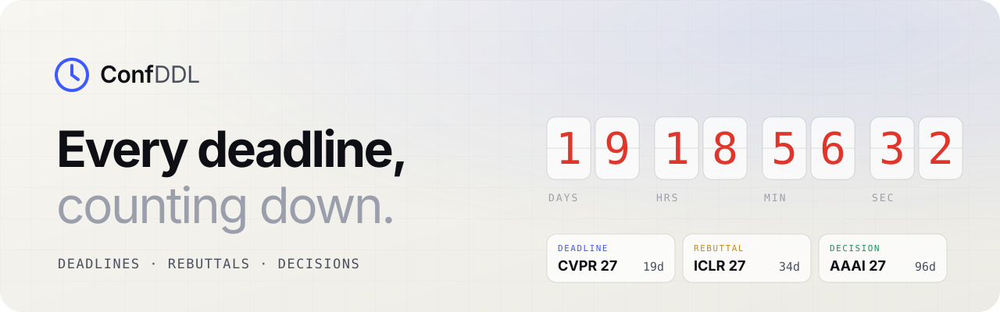

<a href="https://conf-ddl.shyandram.dev/">
  <picture>
    <source media="(prefers-color-scheme: dark)" srcset="docs/banner-dark.svg">
    
  </picture>
</a>

<h1 align="center">Conf DDL · Every deadline, counting down</h1>

<p align="center">
  Live countdowns to computer vision, ML, AI and NLP conference deadlines.<br>
  The countdown follows each paper from submission through rebuttal to the decision.
</p>

<p align="center">
  <a href="https://conf-ddl.shyandram.dev/"><b>Open the site →</b></a>
  &nbsp;·&nbsp;
  <a href="https://github.com/shyandram/conf-ddl/issues">Suggest a conference</a>
  &nbsp;·&nbsp;
  <a href="LICENSE">MIT</a> / <a href="data/LICENSE">CC BY 4.0</a>
</p>

<br>

<p align="center">
  <picture>
    <source media="(prefers-color-scheme: dark)" srcset="docs/desktop-dark.jpg">
    
  </picture>
  &nbsp;
  
</p>

## What it does

| | |
|---|---|
| **⏱ Countdown** | The next deadline, over a 2.5D panorama of the host city that moves with depth and turns from dawn to day, dusk and night with your clock, with its live rain, snow or fog, with the local time and links to the city's sights and official visitor site. After submission closes, it counts down to the rebuttal and then the decision. |
| **⌕ Search and filters** | Filter by field, NYCU A/B, CCF-A/B or confirmed dates, and see everything on a timeline (3 months to a year, as an axis or month by month). |
| **↻ Planner** | Find where a paper can go next, during the rebuttal or after the decision. |
| **★ Star** | Follow a series every year. Stars sync between your phone and computer. |
| **▦ Calendar** | Subscribe to a feed that updates with the data: all deadlines, one field, one series, or just your starred ones. |
| **↗ Share** | `…/#c=cvpr27` opens the page with that countdown. |

The page shows both local time and AoE, has light and dark themes, and works on phones.

## Run locally

```bash
python3 -m http.server 8000   # → http://localhost:8000
```

Every push to `main` validates the data and deploys to GitHub Pages.

## Add a conference

Ask Claude Code, e.g. *"add the ECCV 2028 deadline"*. It follows [`CLAUDE.md`](CLAUDE.md). You can also edit `data/conferences.json` by hand:

```json
{
  "id": "eccv28", "title": "ECCV", "year": 2028,
  "full_name": "European Conference on Computer Vision",
  "area": ["CV"], "link": "https://eccv.ecva.net/",
  "deadline": "2028-03-03 23:59", "timezone": "AoE", "status": "estimated",
  "place": "TBA", "rebuttal": ["2028-05-01", "2028-05-10"], "decision": "2028-06-15"
}
```

<details>
<summary><b>Fields</b></summary>
<br>

**Required:** `id` · `title` · `year` · `full_name` · `area` · `link` · `deadline` (`YYYY-MM-DD HH:MM`) · `timezone` (`AoE`, `UTC+8`, `PDT`, …) · `status` (`confirmed` / `estimated`)

**Optional:** `abstract_deadline` · `date` · `place` (`"City, Country"`, `"Japan (TBA)"`, `"TBA"`, `"Virtual"`) · `rebuttal` (`[start, end]` or `false`; days, or `YYYY-MM-DD HH:MM` when the venue states the time; a bare end day closes at 23:59) · `rebuttal_timezone` (if the rebuttal runs on a different zone than the deadline) · `decision` · `ccf` · `kind` (`workshop` / `workshop-paper` / `challenge`) · `series` · `note`

Check your changes with `python3 scripts/validate.py`.
</details>

<details>
<summary><b>Optional services</b></summary>
<br>

- **City photos:** add an `UNSPLASH_ACCESS_KEY` secret, then run *Actions → Refresh city photos*.
- **City scenes:** add an `OPENAI_API_KEY` secret, then run *Actions → Generate city scenes* (four images per city).
- **My conferences calendar and star sync:** a small Cloudflare Worker. See [`worker/README.md`](worker/README.md).
</details>

## License

Reuse is welcome, with credit.

- **Code:** [MIT](LICENSE).
- **Conference data:** [CC BY 4.0](data/LICENSE). Credit it as *"Deadline data from [Conf DDL](https://github.com/shyandram/conf-ddl), CC BY 4.0"*.
- **City photos:** these belong to their photographers on [Unsplash](https://unsplash.com/license).

<sub>Dates marked <i>estimated</i> are projected from the previous cycle. Always confirm with the official call for papers.</sub>
