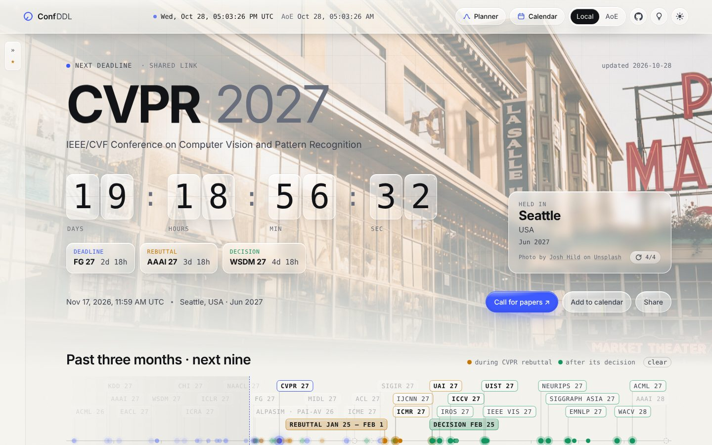
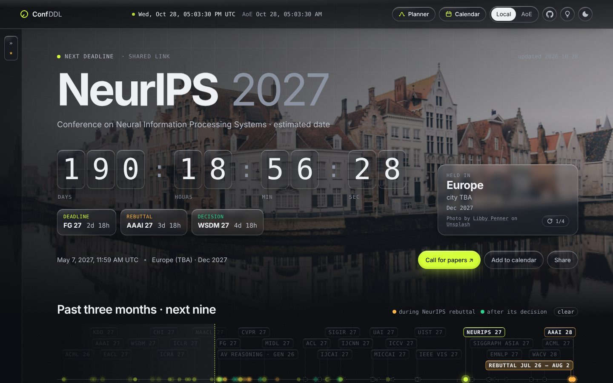
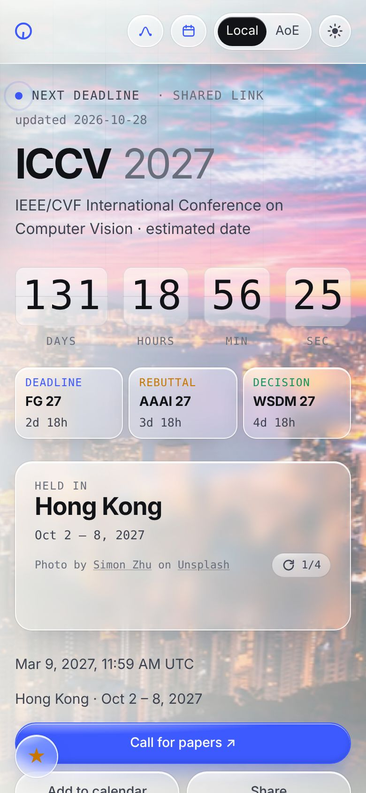
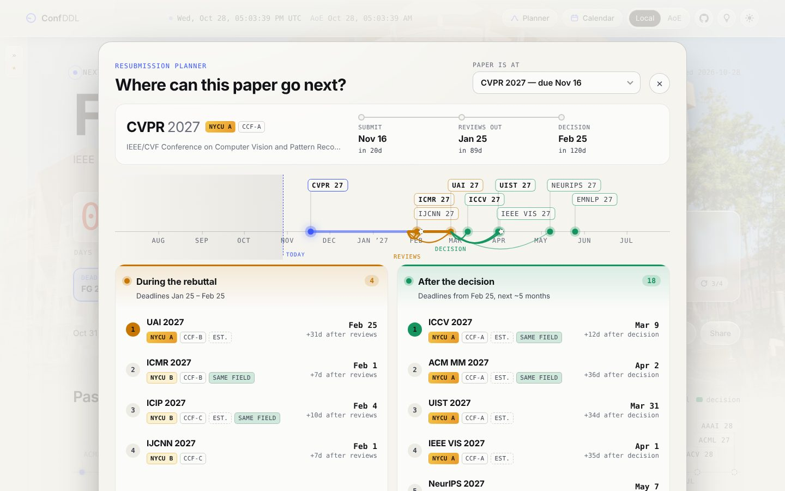

# Conf DDL

**Live countdowns to conference deadlines in computer vision, ML, AI, NLP and neighbouring fields, with each venue's rebuttal and decision dates and a planner for where to resubmit next.**

[](https://conf-ddl.shyandram.dev/)
[](https://github.com/shyandram/conf-ddl/actions/workflows/pages.yml)


<p align="center">
  
</p>

<table>
  <tr>
    <td width="62%"></td>
    <td width="38%" rowspan="2" align="center"></td>
  </tr>
  <tr>
    <td></td>
  </tr>
</table>

**Covers 80+ entries from 50+ series:** CVPR · ICCV · ECCV · WACV · BMVC · ACCV · 3DV · NeurIPS · ICML · ICLR · AISTATS · UAI · COLM · AAAI · IJCAI · ACL · EMNLP · NAACL · COLING · EACL · SIGGRAPH (Asia) · Eurographics · ACM MM · ICME · ICMR · ICASSP · ICIP · ICPR · FG · MICCAI · ISBI · MIDL · ICRA · IROS · KDD · WWW · SIGIR · CIKM · ICDM · WSDM · ECML-PKDD · CHI · UIST · IEEE VIS. Also covers CVPR, ICCV, ECCV and NeurIPS workshops, NTIRE, and challenge tracks.

## Contents

- [Features](#features)
- [Shortcuts and links](#shortcuts-and-links)
- [How it works](#how-it-works)
- [Run locally](#run-locally)
- [Deploy](#deploy)
- [Adding or updating a conference](#adding-or-updating-a-conference)
- [City photos](#city-photos-unsplash)
- [Calendar Worker and star sync](#calendar-worker-and-star-sync)
- [Credits](#credits)

## Features

### Countdowns
- **Main countdown:** a big, flip-digit clock for the next deadline that matches your filters, over a photo of the host city. The page shows the city's name and dates, and the ↻ button switches photos. When a venue has no photo (TBA, online), the page shows a random scenery photo from the collection.
- **Review timeline:** each card follows submit → rebuttal → decision. Once submission closes, the card counts down to the rebuttal window, then to the decision. Three chips under the main clock switch it to the next deadline, rebuttal or decision.
- **Local / AoE:** shows every time in your timezone or in Anywhere-on-Earth (UTC−12). The top bar shows both clocks.

### Finding venues
- **Search** (`/` to focus, `Esc` to clear) by name, city or field.
- **Filters** by field (CV, ML, AI, NLP, Graphics, Multimedia, Signal & Image, Robotics, Data Mining, HCI, Medical Imaging), plus *Confirmed only*, *NYCU A*, *CCF-A* and *★ Starred*.
- **12-month timeline** of the past three months and the next nine. Confirmed deadlines are solid, estimated ones dashed. Click a conference on the timeline and the deadlines you could move to light up: amber during its rebuttal, green after its decision.
- **Venue grades:** NYCU A / B badges from the NYCU CS top-conference list (`tiers` in the data), next to the CCF rank.
- **Passed** and **Decided** lists keep earlier deadlines for reference.

### Planning
- **Resubmission planner** (top-bar *Planner*, or *Plan resubmission* on a card): given where a paper is now, it ranks the deadlines you can still reach, both during the rebuttal and after the decision. You can chain the steps one after another. Share a plan as `#plan=<id>`.

### Following conferences
- **★ Star** a conference to follow the whole series, every year including future editions. Starred series are pinned in the **My conferences** sidebar (on phones, the ★ button at the bottom left) and take over the main countdown.
- **Sync stars between devices** (*⇄ Sync with another device*): a link or QR code puts your phone and computer on the same star list.
- **Calendars** (top-bar *Calendar*):
  - Feeds for everything, one per field, and one per series. Each has deadline reminders 7 days and 1 day before. Subscribed calendars update whenever the data does.
  - **My conferences** is one live calendar of your starred series. Starring or unstarring updates it without resubscribing.
  - Each conference card also has a one-off `.ics` download.
- **Share** a single countdown: `#c=<id>` opens the page with that conference on the main clock. On phones this uses the system share sheet.

### Look and feel
- **Glass UI** over the city photo, with light and dark themes. *Auto* follows your local time (light from 6:00 to 18:00), and the button cycles through auto, light and dark.
- **Mouse light** (bulb button, desktop only): the cursor lights up nearby glass.
- **Works on phones:** a drawer sidebar and a compact clock. Respects `prefers-reduced-motion`.
- A small service worker keeps photos, fonts and GSAP cached, so repeat visits load fast.

## Shortcuts and links

| | |
|---|---|
| `/` | focus search |
| `Esc` | clear search, close the planner or a dialog |
| `#c=cvpr27` | open with that conference on the main countdown |
| `#plan=cvpr27` | open the planner for a paper at that venue |
| `#sync=<id>` | join another device's star list (made by *Sync with another device*) |

## How it works

```
data/conferences.json ──► index.html + assets/app.js   (page reads the JSON at runtime)
        │
        ├─ scripts/validate.py         schema, dates, timezone / daylight-saving checks (runs on every deploy)
        ├─ scripts/build_calendar.py   calendar/all.ics, area/<field>.ics, series/<series>.ics
        └─ scripts/fetch_city_photos.py ──► data/cities.json   (Unsplash scenery per city)

worker/  Cloudflare Worker: one merged "My conferences" feed per browser + star sync (KV)
```

| Path | What it is |
|---|---|
| `index.html`, `assets/app.js`, `assets/style.css` | the whole site, with no framework and no local build |
| `data/conferences.json` | every deadline, plus the field names and the NYCU tier list |
| `data/cities.json` | city photos and photographer credits |
| `scripts/` | validation, calendar feeds and photo fetching |
| `worker/` | the calendar and sync Worker ([setup](worker/README.md)) |
| `.github/workflows/` | `pages.yml` (validate, build feeds, minify, publish), `city-photos.yml`, `worker.yml` |
| `CLAUDE.md` | how Claude Code adds and refreshes conferences |

Animations use GSAP (Flip + ScrollTrigger) from cdnjs.

## Run locally

```bash
python3 -m http.server 8000
# open http://localhost:8000
```

Opening `index.html` directly with `file://` won't work, because the page fetches the JSON.
To try the calendar feeds locally, run `python3 scripts/build_calendar.py`, which writes them to `calendar/`.

## Deploy

`.github/workflows/pages.yml` runs on every push to `main`: it validates the data, builds the calendar feeds, minifies, and publishes to GitHub Pages.

1. One-time setup: **Settings → Pages → Build and deployment → Source: GitHub Actions**.
2. Push to `main`, or run the workflow from the Actions tab.

All paths in the page are relative, so the site works under `/<repo>/` and at the root of a custom domain.

<details>
<summary>Custom domain</summary>

1. **Settings → Pages → Custom domain**: enter the domain and save. With the Actions deployment, no `CNAME` file is needed in the repo.
2. At your DNS provider:
   - Subdomain: a `CNAME` record pointing to `<user>.github.io`.
   - Apex domain: `A` records to `185.199.108.153`, `185.199.109.153`, `185.199.110.153`, `185.199.111.153`
     (and optionally `AAAA` records to `2606:50c0:8000::153` … `2606:50c0:8003::153`).
3. Once DNS resolves, tick **Enforce HTTPS**.
4. Optional: verify the domain under **GitHub account Settings → Pages** so nobody else can claim it.
5. Update the `--site` URL in `pages.yml` and `SITE` in `worker/wrangler.toml`.
</details>

## Adding or updating a conference

The easy way is to ask Claude Code in this repo, e.g. *"search for the ECCV 2028 deadline and add it"*. It follows [`CLAUDE.md`](CLAUDE.md): it uses the official call for papers, marks projected dates as estimated, and runs the validator. You can also [open an issue](https://github.com/shyandram/conf-ddl/issues) with a link to the call for papers.

To edit by hand, add an entry to `data/conferences.json`:

```json
{
  "id": "eccv28",
  "title": "ECCV",
  "year": 2028,
  "full_name": "European Conference on Computer Vision",
  "area": ["CV"],
  "ccf": "B",
  "link": "https://eccv.ecva.net/",
  "abstract_deadline": "2028-02-25 23:59",
  "deadline": "2028-03-03 23:59",
  "timezone": "AoE",
  "date": "Sep 2028",
  "place": "TBA",
  "status": "estimated",
  "rebuttal": ["2028-05-01", "2028-05-10"],
  "decision": "2028-06-15",
  "note": "Projected from ECCV 2026."
}
```

**Required** fields (`scripts/validate.py` fails without them): `id`, `title`, `year`, `full_name`, `area`, `link`, `deadline`, `timezone`, `status`. Everything else is optional.

| Field | Required | |
|---|:---:|---|
| `id` | ✅ | short name + 2-digit year (`iccv27`), with a suffix for rounds (`wacv28r1`); must be unique |
| `title` | ✅ | short name shown on the page (`ICCV`) |
| `year` | ✅ | edition year |
| `full_name` | ✅ | full conference name |
| `area` | ✅ | one or more field codes declared in the top-level `areas` (`CV`, `ML`, `AI`, `NLP`, `CG`, `MM`, `SP`, `RO`, `DM`, `HCI`, `MED`) |
| `link` | ✅ | official call for papers or conference site |
| `deadline` | ✅ | paper deadline, `YYYY-MM-DD HH:MM` in the timezone the call for papers states |
| `timezone` | ✅ | `AoE`, `UTC`, `UTC+8`, `UTC-7`, `PST`/`PDT`, `EST`/`EDT`, `CET`/`CEST`, … The daylight-saving name must match the date's season (the validator checks this). |
| `status` | ✅ | `confirmed` (from the official site) or `estimated` (projected from the previous cycle; say so in `note`) |
| `abstract_deadline` | | abstract deadline, same format as `deadline` |
| `date` | | conference dates as text (`Oct 2 – 8, 2027`, `Sep 2028`); shown as TBA when missing |
| `place` | | `"City, Country"`; `"Country (TBA)"` when only the country is known (its photos are filed under the country); `"TBA"`; or `"Virtual"`/`"Online"`. Missing counts as TBA. |
| `rebuttal` | | `[start, end]` dates, or `false` if the venue has none. Leave it out while unannounced (shows TBA). |
| `decision` | | `YYYY-MM-DD` of the final decision or notification |
| `ccf` | | CCF rank, `A` / `B` / `C` |
| `kind` | | `"workshop"` (workshop proposals), `"workshop-paper"`, or `"challenge"` (left out of the planner); omit for main conferences |
| `series` | | only when a `title` differs from the rest of its series (e.g. `"IJCAI-ECAI"` → `"IJCAI"`), so stars follow it |
| `note` | | free text shown on the card (e.g. where an estimate comes from) |

The top-level `tiers` (`{ "name", "source", "A": [...], "B": [...] }`) holds the grade list behind the badges and the planner's ranking.

Then run:

```bash
python3 scripts/validate.py
```

## City photos (Unsplash)

The countdown's background is a photo of the host city. `scripts/fetch_city_photos.py` gets the photos from Unsplash and writes `data/cities.json` with each photo's URL and photographer credit. It keeps only scenery and street scenes: no portraits, food, pets or indoor shots.

One-time setup:

1. Create a free app at <https://unsplash.com/oauth/applications> and copy its **Access Key**.
2. **Settings → Secrets and variables → Actions → New repository secret**, named `UNSPLASH_ACCESS_KEY`.
3. **Actions → Refresh city photos → Run workflow.**

The workflow also runs when `data/conferences.json` changes, and every hour until every city has photos. It commits the new photos and redeploys.

- Each city gets four photos; the free tier allows 50 requests an hour, so each run fills 9 cities.
- To swap a photo, run the workflow with `refresh` set to the city name (e.g. `Tokyo`) or `all`.
- In `data/cities.json`, a city can have its own `"query"`, or `"pin": true` to keep its photos.

## Calendar Worker and star sync

The per-field and per-series feeds are static files. The combined **My conferences** feed and star sync need the small Cloudflare Worker in [`worker/`](worker/README.md), which the free plan covers. `.github/workflows/worker.yml` deploys it once the `CLOUDFLARE_API_TOKEN` and `CLOUDFLARE_ACCOUNT_ID` secrets are set. Without the Worker, the Calendar dialog offers a one-off download instead.

## Credits

- Photos by their photographers on [Unsplash](https://unsplash.com/), credited on the page.
- Venue grades from the NYCU CS top-conference list; CCF ranks from the China Computer Federation list.
- Dates come from each conference's official call for papers. Entries marked **estimated** are projections, so always check the official site before you submit.
